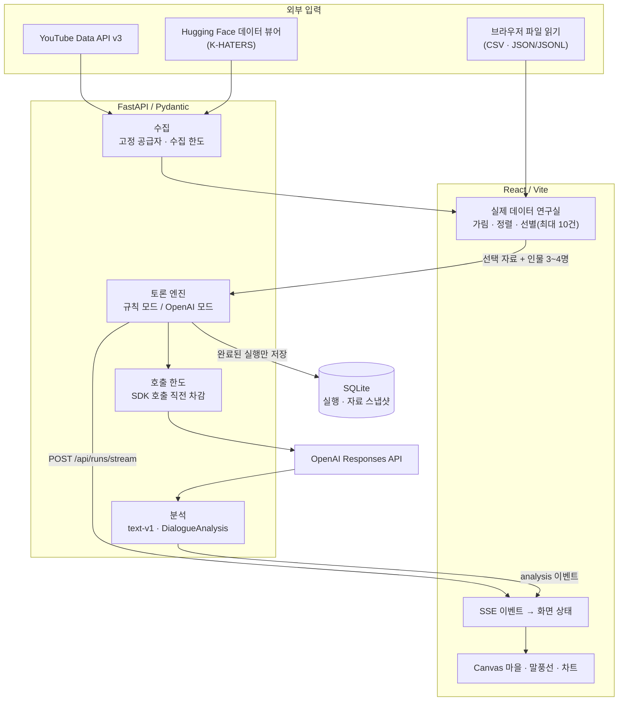

[README_TOP.md](https://github.com/user-attachments/files/34005001/README_TOP.md)
# EchoChamber

> **어떤 정보가, 누구의 대화에서 달라지는가?**

**EchoChamber는 실제 댓글·리뷰를 가상 마을의 3~4인 토론으로 옮겨, 원문과 가상 대화를 같은 분석 기준으로 비교해 보는 실험 워크벤치입니다.** 여론을 예측하거나 사실 여부를 판정하는 도구가 아닙니다. 수집한 자료와 가상 대화가 어디서 어떻게 달라지는지 관찰하는 작은 연구 도구입니다.

[**라이브 데모**](https://echochamber-y3r4.onrender.com/) · [발표 자료 (HTML)](https://echochamber-y3r4.onrender.com/presentation/) · [코드 지도](#코드-지도) · [엔지니어링 결정](#엔지니어링-결정) · [한계](#한계와-검증-범위)

`React` `Vite` `FastAPI` `Pydantic` `SQLite` `SSE` `OpenAI Responses API` `Canvas`

> 데모는 무료 인스턴스라 첫 접속이 느릴 수 있고, 재배포 시 저장된 데이터가 초기화될 수 있습니다. AI 토론·AI 분석은 서버에 API 키가 있을 때만 동작하며, 키가 없어도 규칙 모드로 전체 흐름을 확인할 수 있습니다. GitHub Pages의 정적 화면(`index.html`)은 이전 버전이며 이 React 버전과 다릅니다.

---

## 한눈에 보기

```
수집·가져오기 → 익명화·저장 → 정렬·선별(최대 10건) → 3~4인 토론 → 분석·비교·다운로드
```

| 단계 | 하는 일 | 범위 |
|---|---|---|
| 수집 | YouTube 공식 API(댓글·답글), K-HATERS 표본, 직접 붙여넣은 리뷰·CSV | 1회 최대 30건 |
| 익명화 | 작성자·ID를 가명으로 바꾸고 연락처·계정·URL을 브라우저와 서버에서 모두 가림 | 저장 전 미리보기 확인 |
| 선별 | 수집 순서·긴 문장·AI 부정 감정·별점으로 정렬, 검색 후 체크 | 토론 자료 최대 10건 |
| 토론 | 인물이 번갈아 자료 요약 → 근거 점검 → 다른 관점 → 종합 정리 | 3~4명, 1~20단계 |
| 비교 | 원문과 가상 발화의 기초 통계·AI 분류·관계망 비교, CSV/JSON/HTML 내보내기 | 같은 모델·분석 버전일 때만 AI 수치 직접 비교 |

### 화면

화면은 **합성(가짜) 자료와 규칙 모드**로 촬영했습니다. 실제 여론이나 모델 성능을 보여주는 이미지가 아닙니다.

**1. 자료 정렬·선별 → 3~4인 토론 준비**


**2. 발언 기록이 움직임이 되는 픽셀 마을** — 저장된 발언자·청자·단계에 맞춰 인물이 걷고 만납니다.


**3. 토론·대화 흐름 분석** — 규칙 모드라서 AI 의미 분석은 비어 있고(0/4), 이를 0% 감정으로 꾸며 표시하지 않습니다.


---

## 아키텍처

FastAPI가 React 정적 빌드와 API를 같은 Origin에서 제공합니다. 실시간 경로(SSE)와 저장 경로를 분리했습니다.



**SSE 이벤트 순서**: `start` → `step` → `analysis` → (단계 반복) → `complete` 또는 `error`
발화(`step`)를 먼저 보여주고, 뒤따라 도착하는 `analysis`(감정·확실성·평판 영향)를 같은 단계의 말풍선에 병합합니다. 스트리밍 단위는 **완성된 발화 한 건**이며 토큰 단위가 아닙니다.

---

## 엔지니어링 결정

"무엇을 만들었나"보다 "무엇을 선택했고 무엇을 감수했나"를 적었습니다.

| 결정 | 이유 | 감수한 한계 |
|---|---|---|
| **발화 단위 SSE** (토큰 스트리밍 아님) | SDK가 완성된 응답을 돌려주므로 이를 발화 이벤트로 바로 전달. 분석은 늦게 도착해도 같은 말풍선에 합쳐 체감 대기를 줄임 | 글자가 타이핑되는 효과는 없음 |
| **실패·중단 시 부분 실행을 저장하지 않음** | 히스토리에는 끝까지 완료된 실험만 남아 비교 기준이 흔들리지 않음 | 중간 결과는 사라짐. 연결이 끊겨도 서버 저장은 끝났을 수 있어 히스토리로 완료 여부를 확인해야 함 |
| **요청 한도 + SDK 호출 단위 차감** | IP당 시간당 요청 수와 서버 일일 호출 시도 수를 분리. 각 외부 호출 직전에 SQLite 트랜잭션으로 차감하고 재시도·실패도 세며 SDK 자동 재시도는 끔 | 한도는 **호출 시도 수**이며 토큰·금액이 아님. OpenAI 프로젝트 예산·알림을 별도로 설정해야 함 |
| **구조화 분석 + 버전 고정** | `responses.parse`로 `DialogueAnalysis`(가십·감정·확실성·평판 영향)를 스키마로 받고 `ANALYSIS_VERSION`을 기록. 같은 모델·버전일 때만 AI 수치를 직접 비교 | 분류 정확도는 아직 사람 평가로 검증하지 않음 |
| **계정 대신 브라우저 접근 키** | 브라우저가 만든 64자리 키의 해시만 서버에 저장하고, 키가 있는 사용자만 자신의 자료·연결 실험을 조회. 실제 데이터와 연결된 실험은 공개 목록에서 제외 | 로그인 시스템이 아님. 사이트 저장소를 지우면 복구 불가 |
| **자유 크롤링 대신 고정 수집 경로** | YouTube 공식 API(부모-답글 관계 유지), K-HATERS(CC BY 4.0 출처 표시). KOLD는 재배포 범위를 확인하지 못해 사용자가 확보한 파일만 받음. 수집 한도와 YouTube 자료 29일 만료 적용 | 수집원이 제한적이고 API 키가 필요함 |
| **규칙 모드를 별도로 표시** | API 키 없이 전체 흐름을 시연할 수 있게 하되, AI 토론으로 표시하지 않음 | 규칙 모드 결과는 의미 분석이 아님 |
| **이중 가림 처리** | 브라우저에서 연락처·URL을 가린 뒤 서버에서 다시 적용. 원본 파일·파일명·원래 작성자 ID는 서버로 보내지 않음 | 이름·주소 등은 자동으로 못 잡으므로 사용자 확인 필요 |
| **발언 기록으로 마을을 움직임** | 24×18 타일 Canvas, 프레임 루프, BFS 4방향 경로 탐색을 저장된 `speaker/listener/step`과 동기화 | Pixel Agents에서 이식한 코드·스프라이트 포함(MIT 고지는 `THIRD_PARTY_NOTICES.md`) |

<!-- TODO(작성자): 픽셀 마을에서 직접 구현한 부분(이벤트-이동 동기화, 장면 구성 등)을 1~2문장으로 구분해 적어 주세요. -->

---

## 코드 지도

| 영역 | 파일 | 책임 |
|---|---|---|
| 화면·선별 | `frontend/src/main.jsx`, `frontend/src/RealDataLab.jsx` | SSE 수신·화면 전환 / 정렬·선택·비교·내보내기 |
| 실행·분석 | `app/routers/workbench.py`, `app/services/text_analysis.py` | 자료 확인·인물 배정·생성·분석·저장 / 공통 분류 계약 |
| 수집·보호 | `app/services/collection.py`, `app/services/data_access.py`, `app/services/limits.py` | 고정 공급자·출처 서명·쿼터 / 소유자 경계 / 호출 한도 |
| 시각화 | `frontend/src/DiscussionResults.jsx`, `frontend/src/VillageScene.jsx` | 지표·차트 / 마을 Canvas |
| 저장 | `app/services/runs.py`, `app/services/datasets.py` | SQLite 실행·자료 저장 |

---

## 한계와 검증 범위

### 확인한 것

- 서버 테스트 34개, Node 테스트 10개 (검토 기준 커밋 `5b0ffce`). 임시 DB·실제 HTTP·모의 AI 사용
- 브라우저 검증: 자료 선별 → 4인 실행 → SSE → 그래프 → 비교, 모바일·기존 기능 회귀
- 실서비스 확인: K-HATERS 실제 수집·저장, 4인 규칙 실행, 비공개 비교, 테스트 자료 삭제

```bash
.venv/bin/python -m unittest discover -s tests -v
node --test tests/csv.test.mjs tests/town.test.mjs
.venv/bin/python tests/browser_discussion.py
```

### 보장하지 않는 것

- **AI 분석의 정확도.** 실제 OpenAI 응답 품질과 분류 정확도는 평가하지 않았습니다. AI 모드는 테스트 대역으로 경로와 호출 수만 확인했습니다.
- **사실성·의미 왜곡의 측정.** 신뢰도는 인물 성향에 따른 감쇠값이고, 변화율은 첫 자료와의 문자열 차이입니다. 서로 다른 자료를 다루는 데서 오는 주제 차이도 포함합니다.
- **공격성 라벨 = 가십의 정답이 아님.** K-HATERS 등의 참고 라벨은 공격성에 관한 것이며 가십·사실성의 정답으로 쓰지 않습니다.
- **개인정보 완전 보호.** 자동 가림은 연락처·계정·URL 위주이며, 접근 키는 로그인·암호화 저장을 대신하지 않습니다.
- **대규모 부하, YouTube 키 유효성, 영속 저장.** 무료 인스턴스의 로컬 SQLite는 재배포 시 사라질 수 있어 영속 볼륨이 필요합니다.
- **자료 배정 ≠ 근거 인용 검증.** 인물에게 자료를 번갈아 배정한 것이지, 정확히 인용했다는 검증이 아닙니다.

### 다음 단계

사람이 직접 라벨링한 소규모 평가셋으로 AI 분류 일치율 측정 · 출처 인용 검증 · 토큰/비용 기준 예산 · 계정 권한 · PostgreSQL과 작업 큐

---

<details>
<summary><b>English summary</b></summary>

**EchoChamber** is a small research workbench that moves real comments and reviews (YouTube official API, K-HATERS samples, user-provided files) into a 3–4 agent discussion in a pixel village, then compares the original text with the simulated conversation under the same analysis contract. Built with React/Vite, FastAPI/Pydantic, SQLite, SSE and the OpenAI Responses API (structured outputs). It does not predict real public opinion or verify facts; trust and change metrics are experimental indicators, and AI classification accuracy has not been evaluated yet. Screenshots use synthetic data in rule mode.

</details>

---

<!-- 아래에 기존 "실행", "작은 실험을 완주하는 흐름", "데이터와 API", "호출 보호와 데모 설정", "실제 데이터 비교 연구실", "배포" 섹션을 이어서 둡니다. 맨 아래 "기존 프로젝트 소개"는 삭제하세요. -->
